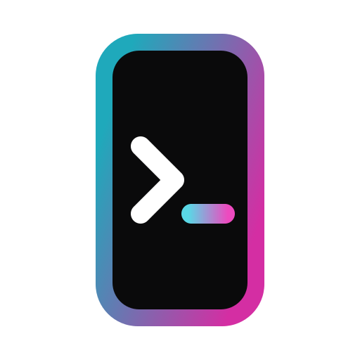

<p align="center">
  
</p>

<h1 align="center">OMP Mobile</h1>

<p align="center">
  <a href="README.md">English</a> ·
  <a href="README.zh-CN.md">简体中文</a>
</p>

<p align="center">Your oh-my-pi sessions, on your phone.</p>

OMP Mobile is a native phone app for [oh-my-pi](https://github.com/can1357/oh-my-pi) (OMP), with a small daemon on each computer. Start, follow and steer OMP sessions from the phone: transcript, tool calls, approvals, and the sessions you started in a terminal.

- **Native app:** The app draws the transcript, tool cards, thinking, Markdown and composer itself, in OMP's own look (Geist, JetBrains Mono, the π mark). No WebView, no web page.
- **A transcript you can follow:** each stretch of tool calls folds into one card that shows the step running now and sums itself up when done ("Edited 2 files, ran 3"); tap a step for its command, diff and output. The view stays on the newest message while you are at the bottom and stays put while you read back.
- **The whole transcript:** images the user sent and images tools produce (screenshots, opened files), edit diffs with their intent, tool results, Markdown tables, OMP's todo list, context usage and queued messages.
- **Model switching:** tap the model in the composer to pick from OMP's catalog — grouped by provider and searchable — and set its thinking level. The model chip follows the session when it changes.
- **Photos to the agent:** attach photos from the library or the camera; they are downscaled on the phone and sent with your message.
- **Approvals on the phone:** OMP's own tool approvals and questions arrive as a sheet, and the turn waits for your answer.
- **Terminal sessions:** Sessions you started in a terminal on the computer are listed too and continue on the phone. One still open in a terminal waits until that terminal exits.
- **Notifications:** Android notifications for approvals, questions, and finished turns while the app is in the background.
- **All your machines:** Pair each computer by QR code and give it a name on the phone. Tap a chat's title for every session on every computer — searchable, with what needs you first. The app opens on the computer you used last; a reopened chat shows at once, also offline.
- **Search and fork:** Search a computer's sessions by title and by anything said in them; a hit opens the chat at that message. Long-press a session to fork it whole, or long-press a message in a chat to fork from there. A fork is a new session; the original file is never changed, even while a terminal has it open.
- **Tailscale, or a relay:** The daemon listens on the computer's Tailscale address and admits only your own devices. Without Tailscale, it can be reached through the open-source ds-harness-remote relay, end-to-end encrypted.
- **An OMP plugin:** `/mobile` in OMP starts the daemon in the background and shows the pairing code. The daemon keeps running after the terminal closes.

## Getting started

### Prerequisites

- On every computer: OMP 18.x
- [Tailscale](https://tailscale.com) signed in to the same account on the computer and the phone, or the relay (below)
- An Android phone

### Computer

Install the plugin into OMP on every computer:

```bash
omp plugin install omp-mobile
```

Then in OMP, run `/mobile`. It starts the daemon in the background, bound to the computer's Tailscale address, and shows a pairing code above the composer until the phone connects. The daemon runs on the Bun inside OMP and outlives the terminal and OMP; `/mobile status` shows it and `/mobile stop` ends it. After `omp plugin upgrade omp-mobile`, `omp-mobile restart` puts the running daemon on the new version with the same settings, once no session is mid-turn (safe to run from a phone session). Phone sessions start in the directory where you ran `/mobile` the first time.

Without the plugin, the same daemon runs from npm (Node.js 22.19 or newer) in the foreground: `npm install -g omp-mobile`, then `omp-mobile --host tailscale --cwd ~/project`. It prints the same code.

### Phone

Install the APK from the [releases page](https://github.com/Rinai-R/omp-mobile/releases). In the app, tap **Add computer (+)**.

- **With an account (recommended):** sign in with GitHub, Google or Zhihu (or email and password) on the public [ds-harness-remote](https://github.com/liguobao/ds-harness-remote) relay. The sheet lists the account's computers; **Add a new computer** shows a one-time code (`ABCD-EFGH`, ten minutes, one use). On the computer, run `/mobile login ABCD-EFGH` in OMP, or `omp-mobile relay login ABCD-EFGH` in a terminal: the computer joins the account with no password of its own (the relay is turned on if the daemon ran without it), and the phone adds it by itself.
- **Other ways:** **Scan to pair** the QR code the computer shows, **Direct address** for a Tailscale or LAN address and token (a pairing link can be pasted there too), or **Self-hosted relay** for your own server.

#### Sessions in herdr

When the computer runs herdr-core terminals (`hc`), a session whose omp runs in one opens on the phone through herdr instead of being taken over: the omp stays in its terminal, the phone types into it once your own draft there is sent or cleared, Stop interrupts it, and its tool approvals and questions show their dialog box with keys that go in only while that dialog is still up. Messages arrive whole as omp writes them. `omp-mobile --herdr off` turns it off; `--herdr on` refuses to fall back to a takeover while herdr is down.

Two limits: herdr has no compare-and-set for keys, so if you answer the same dialog in the terminal in the instant between the phone's check and its keys, those keys land on whatever omp shows next. And a phone message waits for a draft you are typing in an attached terminal (it goes in on its own once you send or clear yours); text put in with `hc keys` does not count as typing and can be joined to it.

#### Through the relay (no Tailscale)

The daemon can also be reached through the public relay of [ds-harness-remote](https://github.com/liguobao/ds-harness-remote) (`https://dsh.r2049.cn`), with no Tailscale and no account. In OMP run `/mobile relay` (or start the daemon with `omp-mobile --relay` and run `omp-mobile relay pair`). Scan the code it shows (**Other ways → Scan to pair**), or paste its link into **Direct address**; the phone shows the computer's key fingerprint and an 8-digit code, which you type where the computer asks. Traffic is end-to-end encrypted between the phone and the daemon (Noise IK, both keys pinned); the relay only forwards ciphertext. Everything works as over Tailscale. `omp-mobile relay status` lists paired phones, `omp-mobile relay revoke <id>` removes one, and removing the computer on the phone ends the pairing too.

A device on your Tailscale account that has the token can run anything OMP can on that computer.

#### Self-hosted relay with account login

The phone and daemon sign in to the same self-hosted relay account, exchanging the password for persistent device credentials. The relay discovers computers and forwards end-to-end encrypted traffic. Deployment details are maintained in the [upstream server documentation](https://github.com/liguobao/ds-harness-remote/tree/main/apps/server).

In the app, **Other ways → Self-hosted relay** takes the server's address and offers what that server supports: its browser sign-ins, or account and password. Once signed in, computers join the same way as on the public relay, with `/mobile login <code> <url>` (the app shows the command with the address). On a server that cannot make computer codes, start the daemon with `omp-mobile --relay <url>` and sign the computer in with `omp-mobile relay login <email>` or `/mobile login`; the password prompt hides input and later starts only need `--relay <url>`. To sign out, use `omp-mobile relay logout` or `/mobile logout`.

The app reuses saved credentials to discover additional computers. Account-based connections keep one active tunnel because the self-hosted server replaces concurrent connections from the same client device; other computers' online status comes from the relay. Switching computers closes the previous tunnel first. Anonymous pairing uses its existing connection flow.

## Development

- `daemon`: the computer side (Node.js), which runs OMP in RPC mode and serves the app
- `app`: the phone app (Expo, React Native)
- `app/modules/omp-attention`: the Android notification service (Kotlin)

```bash
npm install
npm run typecheck
npm test                         # daemon and app

npm start -w @omp-mobile/app     # Expo dev server

# Android APK (JDK 17, Android SDK); app/android is generated, not committed
cd app && npx expo prebuild --platform android --clean --no-install
cd android && ./gradlew assembleRelease
```

Against an emulator, run the daemon from the checkout with `npm run daemon -- --host 127.0.0.1` and forward the port with `adb reverse tcp:7390 tcp:7390`. How the daemon works, its options and HTTP API, and the source map are in [ARCHITECTURE.md](ARCHITECTURE.md).

A release is a `v<version>` tag on `main` whose version matches `package.json`, `daemon/package.json`, `app/package.json` and `app/app.json`, with a matching section in [CHANGELOG.md](CHANGELOG.md). CI then publishes `omp-mobile` to npm and a GitHub Release with the APK.

## License

Apache-2.0. OMP Mobile is not affiliated with oh-my-pi or Tailscale.
