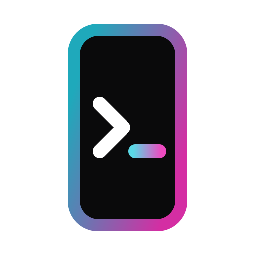

<p align="center">
  
</p>

<h1 align="center">OMP Mobile</h1>

<p align="center">
  <a href="README.md">English</a> ·
  <a href="README.zh-CN.md">简体中文</a>
</p>

<p align="center">Your oh-my-pi sessions, on your phone.</p>

OMP Mobile is a native phone app for [oh-my-pi](https://github.com/can1357/oh-my-pi) (OMP), with a small daemon on each computer. Start, follow and steer OMP sessions from the phone: transcript, tool calls, approvals, and the sessions you started in a terminal.

- **Native app:** The app draws the transcript, tool cards, thinking, Markdown and composer itself. No WebView, no web page.
- **Approvals on the phone:** OMP's own tool approvals and questions arrive as a sheet, and the turn waits for your answer.
- **Terminal sessions:** Sessions you started in a terminal on the computer are listed too and continue on the phone. One still open in a terminal waits until that terminal exits.
- **Notifications:** Android notifications for approvals, questions, and finished turns while the app is in the background.
- **All your machines:** Pair each computer by QR code, switch between them from the session list. A reopened chat shows at once, also offline.
- **Tailscale only:** The daemon listens on the computer's Tailscale address and admits only your own devices. No relay or cloud service of its own.

## Getting started

### Prerequisites

- On every computer: Node.js 22.19 or newer, and OMP 18.x on `PATH`
- [Tailscale](https://tailscale.com) signed in to the same account on the computer and the phone
- An Android phone

### Computer

Run one daemon per computer, bound to its Tailscale IPv4 address (`tailscale ip -4`):

```bash
git clone https://github.com/Rinai-R/omp-mobile.git
cd omp-mobile
npm install
node daemon/src/server.mjs --host 100.x.y.z --cwd ~/project
```

It prints its address, a token, and a pairing link with the same link as a QR code. New sessions start in `--cwd`.

### Phone

Download the APK from the `omp-mobile-android` artifact of the latest [CI run on `main`](https://github.com/Rinai-R/omp-mobile/actions/workflows/ci.yml?query=branch%3Amain) and install it. In the app, tap **Scan to pair** and scan the code the daemon printed. **Enter address** takes the address and token by hand, or a pasted pairing link.

For notifications, open **Settings → Notifications** in the app.

A device on your Tailscale account that has the token can run anything OMP can on that computer.

## Development

- `daemon`: the computer side (Node.js), which runs OMP in RPC mode and serves the app
- `app`: the phone app (Expo, React Native)
- `app/modules/omp-attention`: the Android notification service (Kotlin)

```bash
npm install
npm run typecheck
npm test                         # daemon and app

npm start -w @omp-mobile/app     # Expo dev server

# Android APK (JDK 17, Android SDK); app/android is generated, not committed
cd app && npx expo prebuild --platform android --clean --no-install
cd android && ./gradlew assembleRelease
```

Against an emulator, run the daemon with `--host 127.0.0.1` and forward the port with `adb reverse tcp:7390 tcp:7390`. How the daemon works, its options and HTTP API, and the source map are in [ARCHITECTURE.md](ARCHITECTURE.md).

OMP Mobile is not affiliated with oh-my-pi or Tailscale.
