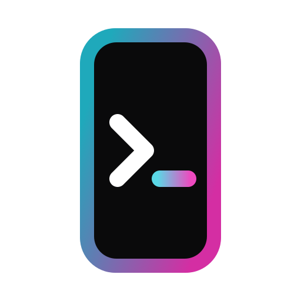

<p align="center">
  
</p>

<h1 align="center">OMP Mobile</h1>

<p align="center">
  <a href="README.md">English</a> ·
  <a href="README.zh-CN.md">简体中文</a>
</p>

<p align="center">在手机上使用你的 oh-my-pi 会话。</p>

OMP Mobile 是 [oh-my-pi](https://github.com/can1357/oh-my-pi)（OMP）的原生手机 App，每台电脑上配一个小 daemon。在手机上新建、查看、引导 OMP 会话：对话记录、工具调用、审批，以及你在终端里开的会话。

- **原生 App：** 对话记录、工具卡片、思考过程、Markdown 和输入框都由 App 自己绘制，沿用 OMP 自己的视觉（Geist、JetBrains Mono、π 标志）。没有 WebView，也不是网页。
- **看得清的对话流：** 连续的工具调用折叠成一张卡片，运行中显示当前步骤，完成后自动汇总（“改了 2 个文件，跑了 3 条命令”）；点某一步可查看命令、diff 和输出。停在底部时视图跟随最新消息，往上翻看时位置保持不动。
- **完整的对话记录：** 用户发送的图片和工具产生的图片（截图、打开的文件）、带意图说明的编辑 diff、工具结果、Markdown 表格、OMP 的待办列表、上下文用量和排队中的消息。
- **切换模型：** 点输入框上方的模型，就能从 OMP 的模型目录里选择（按 provider 分组、可搜索），并设置思考等级。会话的模型变化时，模型标签会跟着更新。
- **给 agent 发图片：** 从相册或相机选图，在手机上压缩后随消息一起发送。
- **手机上审批：** OMP 自己的工具审批和提问以面板形式出现，这一轮会等你回答。
- **终端会话：** 你在电脑终端里开的会话也会列出来，可以在手机上接着用。仍在终端里打开的会话，要等那个终端退出后才能打开。
- **通知：** App 在后台时，审批、提问和任务完成会发安卓通知。
- **所有机器：** 扫码配对每台电脑，并在手机上给它起名。点对话标题即可看到所有电脑上的所有会话——可搜索，需要你处理的排在最前。App 打开时直接进入上次用的电脑；重新打开的对话立即显示，离线也能看。
- **Tailscale 或中继：** daemon 监听电脑的 Tailscale 地址，只放行你自己的设备。没有 Tailscale 时，可经开源的 ds-harness-remote 中继连接，端到端加密。
- **OMP 插件：** 在 OMP 里输入 `/mobile`，就会在后台启动 daemon 并显示配对二维码。终端关掉后 daemon 继续运行。

## 开始使用

### 前置条件

- 每台电脑：OMP 18.x
- 电脑和手机都登录同一个 [Tailscale](https://tailscale.com) 账号，或使用中继（见下文）
- 一台安卓手机

### 电脑

在每台电脑上把插件装进 OMP：

```bash
omp plugin install omp-mobile
```

然后在 OMP 里运行 `/mobile`。它会在后台启动 daemon，绑定到这台电脑的 Tailscale 地址，并在输入框上方显示配对二维码，直到手机连上。daemon 运行在 OMP 自带的 Bun 上，终端和 OMP 退出后它仍在运行；`/mobile status` 查看状态，`/mobile stop` 停止。手机上新建的会话，默认在第一次运行 `/mobile` 的目录下启动。

不装插件也可以：从 npm 安装同一个 daemon（需要 Node.js 22.19 或更新版本），在前台运行：`npm install -g omp-mobile`，然后 `omp-mobile --host tailscale --cwd ~/project`。它会打印同样的二维码。

### 手机

从 [Releases 页面](https://github.com/Rinai-R/omp-mobile/releases)下载 APK 并安装。在 App 里点 **添加电脑（＋）**。

- **用账号（推荐）：** 在 [ds-harness-remote](https://github.com/liguobao/ds-harness-remote) 公共中继上用 GitHub、Google、知乎（或邮箱密码）登录。面板会列出账号下的电脑；点 **添加一台新电脑** 会显示一次性码（`ABCD-EFGH`，10 分钟有效，只能用一次）。在电脑的 OMP 里输入 `/mobile login ABCD-EFGH`，或在终端运行 `omp-mobile relay login ABCD-EFGH`：电脑无需自己的密码即加入该账号（daemon 没开中继时会自动打开），手机随后自动添加它。
- **其他方式：** **扫码配对** 扫描电脑显示的二维码；**直连地址** 填 Tailscale / 局域网地址和 Token（也可粘贴配对链接）；**自建中继** 连接你自己的服务器。

#### herdr 里的会话

电脑上运行 herdr-core 终端（`hc`）时，在其中运行的 omp 会话会经 herdr 在手机上打开，不再接管：omp 留在它的终端里；手机发的消息会等你在终端里的草稿发出或清空后再输入；「停止」会中断它；工具审批和提问显示终端里的对话框和按键，只有对话框没变时按键才生效。消息按整条显示（omp 写入后）。`omp-mobile --herdr off` 关闭；`--herdr on` 时 herdr 不在线也不会退回接管。

两个限制：herdr 的按键没有「比较后再写」，如果你在手机校验完、按键还没送达的一瞬间在终端里回答了同一个对话框，手机的按键会落到 omp 接下来显示的界面上。手机发的消息会等你在已 attach 的终端里正在打的草稿（你发出或清空后它单独输入）；用 `hc keys` 送进去的文字不算打字，可能会和它拼在一起。

#### 通过中继（不用 Tailscale）

守护进程也可以通过 [ds-harness-remote](https://github.com/liguobao/ds-harness-remote) 的公共中继 `https://dsh.r2049.cn` 连接，不需要 Tailscale，也不需要账号。在 OMP 里运行 `/mobile relay`（或用 `omp-mobile --relay` 启动守护进程后运行 `omp-mobile relay pair`）。扫描显示的二维码（**其他方式 → 扫码配对**），或把链接粘贴到 **直连地址**；手机会显示电脑的密钥指纹和 8 位验证码，在电脑提示处输入即可。手机与守护进程之间端到端加密（Noise IK，双方密钥固定），中继只转发密文。功能与 Tailscale 下完全一样。`omp-mobile relay status` 列出已配对手机，`omp-mobile relay revoke <id>` 移除其中一部，在手机上移除这台电脑也会解除配对。

你 Tailscale 账号下持有 token 的设备，可以在那台电脑上执行 OMP 能做的任何事。

#### 自建中继与账号登录

手机与 daemon 登录同一个自建中继账号，将密码换成持久保存的设备凭据。中继负责发现电脑和转发端到端加密的通信。搭建方式见 [原项目服务端文档](https://github.com/liguobao/ds-harness-remote/tree/main/apps/server)。

在 App 里选 **其他方式 → 自建中继**，填服务器地址后会显示该服务器支持的登录方式：浏览器登录，或账号密码。登录后添加电脑的方式与公共中继相同，用 `/mobile login <码> <url>`（App 会显示带地址的完整命令）。服务器不支持生成电脑码时，用 `omp-mobile --relay <url>` 启动 daemon，再用 `omp-mobile relay login <email>` 或 `/mobile login` 登录；密码输入会隐藏，后续启动只需指定 `--relay <url>`。退出登录可用 `omp-mobile relay logout` 或 `/mobile logout`。

App 复用已有凭据发现新电脑。自建服务会替换同一客户端的并发连接，因此账号模式只连接当前电脑，其他电脑通过中继查询在线状态，切换时先关闭旧连接。匿名配对沿用原有连接流程。

## 开发

- `daemon`：电脑端（Node.js），以 RPC 模式运行 OMP 并为 App 提供服务
- `app`：手机 App（Expo，React Native）
- `app/modules/omp-attention`：安卓通知服务（Kotlin）

```bash
npm install
npm run typecheck
npm test                         # daemon 和 app

npm start -w @omp-mobile/app     # Expo 开发服务器

# 安卓 APK（JDK 17，Android SDK）；app/android 由生成得到，不提交
cd app && npx expo prebuild --platform android --clean --no-install
cd android && ./gradlew assembleRelease
```

对接模拟器时，在仓库里用 `npm run daemon -- --host 127.0.0.1` 运行 daemon，再用 `adb reverse tcp:7390 tcp:7390` 转发端口。daemon 的工作方式、选项、HTTP API 和源码结构见 [ARCHITECTURE.md](ARCHITECTURE.md)。

发版就是在 `main` 上打一个 `v<version>` tag：版本号要和 `package.json`、`daemon/package.json`、`app/package.json`、`app/app.json` 一致，[CHANGELOG.md](CHANGELOG.md) 里要有对应的小节。CI 随后把 `omp-mobile` 发布到 npm，并发布带 APK 的 GitHub Release。

## 许可证

Apache-2.0。OMP Mobile 与 oh-my-pi、Tailscale 均无关联。
